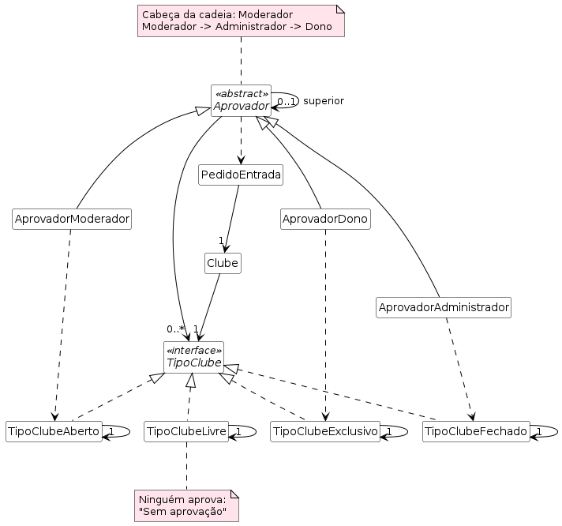

# Chain of Responsibility 
A cabeça da cadeia é o **Moderador**; o pedido sobe **Moderador → Administrador → Dono** até chegar a quem tem o tipo do clube na sua lista.
| Tipo de clube | Quem aprova |
|---|---|
| Aberto | Moderador |
| Fechado | Administrador |
| Exclusivo | Dono |
| Livre | ninguém ("Sem aprovação") |

